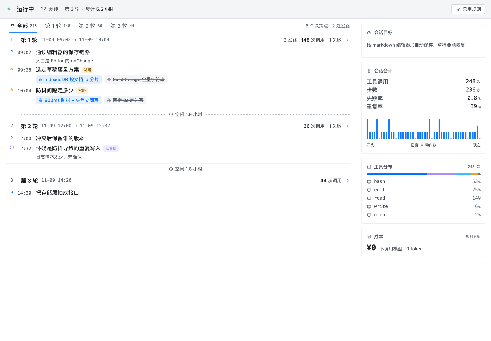

# dsh-session-observer

**A third conversation view for DeepSeek Harness that answers exactly one question:**

> ### Do I need to step in right now?

Chat tells you what was said. Trajectory tells you what happened. This tells you whether **you** are needed — and stays quiet the rest of the time.

- **Rule-based by default.** Every number on the first screen is computed locally from the event stream. No model call, no tokens, no latency, **¥0**.
- **Five verdicts**, not a dashboard: `running` · `stuck` · `erroring` · `waiting` · `dangerous`.
- **Quiet is the feature.** When nothing is wrong it prints four characters and a duration. That emptiness is the product.

---

## The problem

An agent session emits events far faster than a human can read them. The usual response is a summarizer — but a summary of a 30-minute run is just a second thing you have to read.

The real question is not *"what happened"*. It is *"can I go do something else, and when do I have to come back"*.

So this is not a summarizer. It is an **annunciator**: it stays silent while the session is healthy, and speaks only when a human decision is required.

---

## What it looks like

Healthy:

```
   运行中 · 14 分钟

   ▏▏▎▏▎▎▏▏▎▏▏▎▎▏▏▏▎▏▎      ← density band: thickness = activity
   07:31                07:45
```

Stuck:

```
   停滞 · 6 分钟

   6 分钟没有新进展。
```

(The UI ships in Chinese; the strings are a single object at the top of `client.js` if you want to translate it.)

---

## Design

The view is one screen, two columns: the decision spine on the left, the statistics panel on the right, cross-linked — click a turn's tab and both the spine and the numbers follow.



- **Turn sections**, not a wall of events: each turn is a section with its own header, calls, failures and forks.
- **Forks are drawn as two roads**: the chosen one is filled, the abandoned one is struck through. That is the whole point of the spine — you can see what was *not* taken.
- **Idle time is folded**: a 13-hour overnight pause costs one dashed line, not two-thirds of the chart.
- Layout tokens (4/8 radius, 9/11/13/15 type, 7% hairlines, 20×20 icon grid) were measured off the UniFi Network console; colour follows the host's `--dsw-*` semantic tokens so dark mode needs no second stylesheet.

The static prototype that fixed this direction is kept in [`design/`](design/); [`dev/harness/`](dev/harness/) renders the real component without booting DSH.

---

## How it decides

Two naive approaches both fail, and they fail for the same reason — **absolute thresholds applied to a system whose natural tempo spans two orders of magnitude.**

Measured on one real session, 2,357 events:

| quantity | value |
|---|---|
| advance-interval p50 | 3.9 s |
| p90 | 21.5 s |
| **p99** | **265 s** |
| max | 1,934 s |

A "6 minutes = stuck" rule misses every real stall. A `p90 × 3 = 65 s` rule fires 18 times on that same log. **The threshold has to be a property of the session, not of the product.**

### Layer 1 — attribute the silence

Silence is not one state. It is four:

| kind of silence | responsible party | alarm? |
|---|---|---|
| a tool is in flight, not returned | tool | no |
| step ended, no new step | model | yes |
| waiting for approval / your reply | **you** | **never** |
| a tool exceeded its own historical p99 | environment | yes, most urgently |

Most false positives come from collapsing these four into one.

### Layer 2 — the session's own tempo is the baseline

```
stuck_after = max(p99_advance × 1.5, 180 s)
```

The floor exists because any baseline must not make it cry "stuck" within three minutes.

### Layer 3 — in-flight tools carry their own heartbeat

A `bash` call still streaming bytes, a background job registered but not settled — those are evidence of life that no threshold needs to guess at.

### What counts as "advance"

- ✅ a new tool target (reading a new file counts), an assistant text block, a sub-agent or background job lifecycle transition
- ❌ the same call repeated with the same fingerprint — it does **not** reset the timer, so a session that spins in place becomes suspicious on its own

### Cold start

Under 20 advance intervals it only observes, never alarms. A long session's first few minutes should be silent.

### The rule of the product

**Miss rather than mislead.** One false alarm is enough for a user to mute this view forever. Replaying a real 2,357-event log: **0 false "stuck"**, 1 `dangerous`, a handful of `waiting` — all of them real.

---

## The five verdicts

| verdict | dot | condition |
|---|---|---|
| `running` | faint green | healthy progress, or a tool in flight |
| `stuck` | amber | the three layers above agree |
| `erroring` | amber | a tool exceeded its own historical p99 |
| `waiting` | blue | an approval is pending, or the turn was handed back and left idle > 5 s |
| `dangerous` | red | a destructive operation is **currently awaiting your decision** |

`dangerous` is deliberately narrow. The first version fired on "a destructive tool is in flight" and flashed red 23 times in a real log — calls and results pair in the same second, so the user saw a flicker and learned nothing.

**Hard rule: `waiting` never false-positives.** That one is your own doing; alarming on it is blaming the user.

**Hysteresis:** enter an abnormal state immediately, leave it only after 10 s of continuous normality — and only for threshold-shaped verdicts (`stuck`, `erroring`), never for fact-shaped ones (`waiting`, `dangerous`).

---

## Cost

| mode | cost | contents |
|---|---|---|
| rules only (default) | **¥0** | verdict, density band, elapsed ticker — all of it |
| rules + sidecar model | ~¥3 / 8 h | one short annotation per semantic boundary |

The default is free because a plugin that spends money by default can never be installed casually.

In sidecar mode a second model is asked one closed-set question per semantic boundary: *what is it doing, why, and what is the next concrete action*. The answer is a fixed seven-member JSON object — a display, not an essay. The prediction is scored deterministically when the real next action arrives; that hit-rate, not a self-assessment, is the only quality signal the plugin reports.

---

## Install

Requirements: DeepSeek Harness (tested on `0.1.7-rc.1`) and Node ≥ 20.

```bash
dsh plugin --profile web add github:Anilams/dsh-session-observer
```

The command installs the dependency **and** appends the package to `dsh.profile.bundles`. Restart `dsh web`, and a third tab appears next to Chat and Trajectory.

> If you install by hand (editing `package.json` yourself), you **must** also run:
>
> ```bash
> dsh plugin --profile <name> install
> ```
>
> Otherwise the host silently skips the whole bundle. The only symptom is a line in `--dump-config`:
>
> ```
> dsh: skipping profile bundle "dsh-session-observer": cannot resolve ...
> ```

Uninstall:

```bash
dsh plugin --profile web remove dsh-session-observer
```

---

## Configuration

`cordis.patch.yml` ships with a working default. Every key lands in `apply(ctx, config)`.

| key | default | meaning |
|---|---|---|
| `enabled` | `true` | master switch |
| `mode` | `"free"` | `free` = rules only; `smart` = also call the sidecar model |
| `intervalMs` | `25000` | minimum spacing between sidecar calls |
| `minNewEvents` | `3` | skip the call if the window has fewer new events |
| `maxTokens` | `400` | must be explicit; the host sets no cap for you |
| `reasoningEffort` | `"off"` | **must be explicit** — omitted, DeepSeek falls back to `high` and cost ×3–5 |
| `timeoutMs` | `15000` | end-to-end deadline per sidecar call |
| `provider` / `model` | empty | empty = follow the session's recorded `request/header` |
| `maxInflight` | `1` | self-built concurrency gate (the `llm` layer has none) |
| `urgentFailStreak` | `2` | ignore the interval after this many consecutive failures |

The first time you open the view it asks once whether you want to pay for the sidecar model, and remembers your answer.

---

## Data and privacy

**Nothing leaves your machine in the default mode.** `free` mode makes zero network calls; the verdict, the band and the ticker are pure functions of the local event stream.

Notes produced in `smart` mode are stored **locally**:

```
$DSH_HOME/storages/session-observer/notes/<sessionId>.jsonl
```

one JSON line per note, appended, capped, safe against a corrupt tail. They are never uploaded, never sent to a server, and there is no telemetry of any kind.

The only outbound traffic in `smart` mode is the annotation request to **your own configured model provider**: the session goal, a summary of recent tool calls, and a ≤480-character prefix of the model's reasoning. Tool arguments are truncated at 120 characters.

### Why notes are not written into the session log

They used to be. `Session.append()` has no way to mark an event `ignorable`, and the read path refuses to interpret **an entire log** containing an unknown event type rather than skipping the line:

```
session "…" contains event type "observer/note" (seq 46) unknown to this harness
and not marked ignorable; refusing to interpret the log
```

That took out 20 historical sessions on 2026-11-06 before it was understood. Since 0.3.0 plugin data lives in plugin storage. See `lib/notes.js` for the full post-mortem.

---

## Architecture

`lib/web-rpc.js` is the fallback transport: it mounts `/session-observer` on the host's `webServer`, verifies the request the same way `connection.requestRejection` does, and answers in the Connection wire format.

```
session/event  (post-commit, fire-and-forget)
        │
        ▼
  lib/fold.js      pure reducer: events → { verdict, spine, metrics }
        │          (also the shape of a dsh-session-projection unit)
        ▼
  lib/verdict.js   the state machine: attribute → baseline → hysteresis
        │
        ▼  RPC /session-observer  { snapshot }
  client.js        one React component, registered as `conversation.view`
```

| file | role |
|---|---|
| `index.js` | host half: event tap, scheduling, sidecar calls, note storage, RPC |
| `lib/fold.js` | pure fold from events to view state |
| `lib/verdict.js` | the five verdicts, three-layer stuck detection, hysteresis |
| `lib/metrics.js` | deterministic metrics: repeats, failure streaks, progress rate, destructive rules |
| `lib/notes.js` | append-only note store with anchor-based replay |
| `lib/prompt.js` | sidecar prompt and strict seven-member JSON parser |
| `client.js` | the view: verdict, ticker, density band, decision spine |

The client only ever sees a snapshot. It holds no state machine of its own, which is why a browser refresh can never desynchronise it from the host.

---

## Hard constraints

Every one of these cost a crash to learn.

1. **The host half must not import any `@deepseek-ai/*` package.** Under `link:` installs the host cannot resolve bare specifiers; an import-time throw happens *before* `apply`, so the plugin cannot catch it, and the App decides the whole plugin tree is unusable.
2. **`export const inject` must declare every service you touch** — `['llm', 'sessions']` today. cordis throws on first property access otherwise.
3. **`apply` must be wrapped in try/catch.** A plugin is not allowed to break the host's startup.
4. **`reasoningEffort` must be explicit (`'off'`)**, or DeepSeek silently falls back to `high` and costs 3–5×.
5. **`client.js` may only `require('react')`** — it runs in the browser half, where nothing else exists.

`test/no-external-deps.test.mjs` and `test/inject-contract.test.mjs` guard rules 1 and 2; break them and the suite goes red.

---

## Development

```bash
npm test        # 43 tests, plain Node, no external dependencies
```

| what you changed | how it takes effect |
|---|---|
| `client.js` | hot-swaps on save (~0.5–1.5 s) |
| `index.js`, `lib/*` | restart `dsh web` |

The verdict layer is a pure function, so real logs can be replayed wholesale to measure false positives:

```js
import { createState, apply } from './lib/fold.js'
import { judge, cloneVerdict } from './lib/verdict.js'

let state = createState()
for (const event of events) {
  state = apply(state, event)
  const verdict = judge(cloneVerdict(state.verdict), event.time)
  if (verdict.state !== 'running') console.log(event.seq, verdict)
}
```

---

## Roadmap

| version | contents | status |
|---|---|---|
| **0.5.0** | the v9 layout is now the real view: turn sections, forked roads, side panel, host-token theming; host emits `tool_mix` / `turn_stats` / per-node `turn` | this release |
| 0.4.2 | transport: fall back to a self-mounted `webServer` route when native RPC throws, so CLI and desktop both connect; events folded into `beats`; plain-language verdicts | this release |
| 0.3.1 | verdict view: three-layer stuck detection, density band, decision spine | released |
| v1 | promote the fold into a real `dsh-session-projection` unit so the client reads the projection instead of polling RPC | planned |
| v2 | "slow-motion": click a decision point to jump to that seq in the trajectory view | planned |
| v3 | finer attribution: capacity / context / tool / task difficulty | planned |
| v4 | restrained write-back: inject one corrective line when a loop is detected (explicit opt-in only) | planned |

## Non-goals

- ❌ charts — slower than a sentence
- ❌ a configurable metrics panel — if it is configurable, nobody reads it
- ❌ a permanently expanded history list — that is just a worse transcript
- ❌ red in a healthy state
- ❌ emoji as status
- ❌ automatic intervention — an observer with side effects is no longer an observer
- ❌ a single composite "score"

---

## Status

Verified on a real DSH instance and a real Chromium: the plugin resolves in the profile, the host half loads without a fatal error, the client bundle is served, the third tab renders, styles are injected, and the page reports **zero** `pageerror` / `console.error`. Notes are being written to disk continuously by the running app.

| host | status |
|---|---|
| DSH desktop app (`dsh-client-connection` 0.2.x) | ✅ works — native RPC channel |
| CLI `dsh web` (`dsh-client-connection` 0.1.7-rc.1) | ✅ works — self-mounted route |

On the CLI build, `ctx.connection.rpc.handle()` throws `cannot get property "webServer" without inject`. The plugin tries the native channel first and falls back to mounting a prefix route (`/session-observer`) on `webServer` itself, replicating the same wire format and the same rejection check. Both paths are covered by the test suite.

Known boundaries: the tab only appears in a session that already has messages (host behaviour for blank sessions), and attribution does not yet distinguish capacity from context exhaustion.

---

## License

MIT. See [LICENSE](LICENSE).

中文说明见 [README.zh.md](README.zh.md)。
