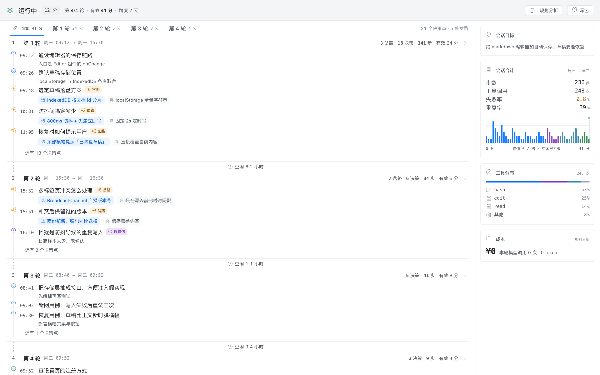

# dsh-session-observer · 观察

**DeepSeek Harness 的第三个会话视图，只回答一个问题：**

> ### 我现在需要插手吗？

「对话」告诉你说了什么，「轨迹」告诉你发生了什么，这个视图告诉你**要不要你亲自看一眼**——其余时间它闭嘴。

- **默认零模型依赖。** 首屏每一个数字都是本地从事件流算出来的：不调模型、不花 token、零延迟、**¥0**。
- **五个判决**，不是一个仪表盘：`运行中` · `停滞` · `异常` · `待确认` · `高风险`。
- **安静本身就是功能。** 一切正常时它只写四个字加一个时长——那片空白是设计出来的。

---

## 它解决什么

一个 agent 会话产生事件的速度远快于人阅读的速度。常见的应对是加一个摘要器——但一次 30 分钟运行的摘要，只是**第二份你还得读的东西**。

真正的问题不是「发生了什么」，而是「**我能不能先去干别的，什么时候必须回来**」。

所以这不是摘要器，是**告示器**：会话健康时保持沉默，只在需要人做决定时开口。

---

## 它长什么样

一切正常：

```
   运行中 · 14 分钟

   ▏▏▎▏▎▎▏▏▎▏▏▎▎▏▏▏▎▏▎      ← 密度带：厚度即动作密度
   07:31                07:45
```

停滞时：

```
   停滞 · 6 分钟

   6 分钟没有新进展。
```

---

## 设计稿

下一代布局在 [`design/`](design/) —— 单文件原型，明暗双主题，令牌取自 UniFi Network 控制台的运行时产物（品牌蓝 `#006eff`、圆角 4/8/16、字号 9/11/13/15、7% 发丝线、20×20 图标网格）。



它把原来两个界面合成一屏：左边决策脊，右边统计栏，互相索引——点轮次的统计，左列跳到那一轮。空闲时段折在「有效时间轴」上，13 小时的过夜空档只占一段虚线，而不是三分之一的横轴。

原型还没接进 `client.js`，先把方向定下来再移植。

---

## 它靠什么判断

两种常见做法都错，而且错在同一个地方——**把绝对阈值套在一套自然节奏差两个数量级的系统上**。

一个真实会话（2357 条事件）实测：

| 量 | 值 |
|---|---|
| 前进间隔 p50 | 3.9 秒 |
| p90 | 21.5 秒 |
| **p99** | **265 秒** |
| 最大 | 1934 秒 |

「6 分钟算卡住」会漏掉全部真实卡顿；「p90 × 3 = 65 秒」会在同一份日志上误报 18 次。**阈值必须是会话的属性，不是产品的属性。**

### 第一层，先归因

「沉默」至少有四种，责任方不同：

| 沉默的性质 | 责任方 | 报警吗 |
|---|---|---|
| 工具在飞、还没返回 | 工具 | 不报 |
| 已结束一步、暂无新步 | 模型 | 报 |
| 在等你批准 / 等你回复 | **你** | **绝不** |
| 工具飞过它自己的历史 p99 | 环境 | 报，且最急 |

绝大多数误报，来自把这四种混成一种。

### 第二层，用会话自己的节奏做基线

```
stuck_after = max(p99_advance × 1.5, 180 秒)
```

地板值的意义：任何基线都不该让它在三分钟内喊卡住。

### 第三层，在飞的工具自带心跳

`bash` 还有字节流出、后台 job 已注册未结算——那是活着的证据，不需要阈值去猜。

### 什么算「前进」

- ✅ 新的工具目标（读一个新文件也算）、assistant 文字块、子代理与后台任务的生命周期变化
- ❌ 同一指纹的重复调用——**不重置计时器**，于是打转的会话会自己变得更可疑

### 冷启动

攒不够 20 个前进间隔前，只观察不报警。长会话的头几分钟保持沉默，这是正确的。

### 产品的纪律

**宁漏不误。** 误报一次，用户就永久静音这个视图。用真实日志回放的结果：**「卡住」0 次误报**，1 次危险、若干次等待——后者都是真实的等待。

---

## 五种判决

| 判决 | 色点 | 条件 |
|---|---|---|
| `运行中` | 极淡绿 | 正常推进，或工具在飞 |
| `停滞` | 琥珀 | 上面三层同时成立 |
| `异常` | 琥珀 | 工具飞过它自己的历史 p99 |
| `待确认` | 蓝 | 待批准，或回合已交回且悬超过 5 秒 |
| `高风险` | 红 | 破坏性操作**正在等你拍板** |

`高风险` 判得很窄是刻意的。最初写成「破坏性工具在飞就算」，结果真实日志里闪了 23 次红——调用与结果通常同一秒配对，用户只看到一次闪烁，既无从反应也无从学习。

**硬规则：`待确认` 永不误报。** 那是你自己的锅，报警等于怪用户。

**迟滞**：进入异常立刻生效，退出异常要持续 10 秒；且只保护阈值型判决（停滞、异常），不保护事实型的（待确认、高风险）。

---

## 成本

| 模式 | 花费 | 内容 |
|---|---|---|
| 只用规则（默认） | **¥0** | 判决、密度带、刻度，全部可用 |
| 规则 + 旁路模型 | 约 ¥3 / 8 小时 | 每个语义边界多说一句话 |

默认档免费，是因为一个默认会花钱的插件不可能被随手装上。

旁路模式下，另一个模型在每个语义边界回答一个封闭问题：这一步在做什么、为什么、下一个具体动作是什么。答案是固定七成员的 JSON——是仪表读数，不是小作文。真实动作到达时确定性比对，命中率（而不是自我评价）是这个插件唯一汇报的质量信号。

---

## 安装

要求：DeepSeek Harness（在 `0.1.7-rc.1` 上验证）与 Node ≥ 20。

```bash
dsh plugin --profile web add github:Anilams/dsh-session-observer
```

这条命令会装依赖，**并**把包追加进 `dsh.profile.bundles`。重启 `dsh web`，标签栏里就会出现第三个标签。

> 如果手工安装（自己改 `package.json`），**必须再跑一次**：
>
> ```bash
> dsh plugin --profile <name> install
> ```
>
> 否则宿主会**静默跳过整个 bundle**，唯一线索是 `--dump-config` 里的一行：
>
> ```
> dsh: skipping profile bundle "dsh-session-observer": cannot resolve ...
> ```

卸载：

```bash
dsh plugin --profile web remove dsh-session-observer
```

---

## 配置

`cordis.patch.yml` 自带可用默认值，所有键都会进 `apply(ctx, config)`。

| 键 | 默认 | 说明 |
|---|---|---|
| `enabled` | `true` | 总开关 |
| `mode` | `"free"` | `free` 只跑规则；`smart` 额外调旁路模型 |
| `intervalMs` | `25000` | 旁路调用的最小间隔 |
| `minNewEvents` | `3` | 窗口内新事件不足就不跑 |
| `maxTokens` | `400` | 必须显式给，宿主不替你设上限 |
| `reasoningEffort` | `"off"` | **必须显式给**，否则 DeepSeek 回落到 `high`，成本 ×3–5 |
| `timeoutMs` | `15000` | 单次旁路调用的端到端时限 |
| `provider` / `model` | 空 | 留空则跟随会话记录的 `request/header` |
| `maxInflight` | `1` | 自建并发闸门（`llm` 层没有并发控制） |
| `urgentFailStreak` | `2` | 连续失败这么多步就无视间隔立刻标注 |

第一次打开视图时会问一次「要不要花钱买总结」，并记住你的选择。

---

## 数据与隐私

**默认模式下没有任何数据离开这台机器。** `free` 模式零网络调用：判决、密度带、刻度全是本地事件流的纯函数。

`smart` 模式产生的 note 存在**本地**：

```
$DSH_HOME/storages/session-observer/notes/<sessionId>.jsonl
```

一行一条 JSON，追加写、有上限、坏行跳过、会话 id 逃不出目录。不上传、不发服务端、没有任何遥测。

`smart` 模式唯一的对外流量，是发往**你自己配置的模型供应商**的标注请求：会话目标、近期工具调用摘要、模型 reasoning 的 ≤480 字符前缀。工具参数在 120 字符处截断。

### 为什么 note 不写进会话日志

以前是写进去的。`Session.append()` 没有写入 `ignorable` 的入口，而读路径遇到「不认识的类型且没标 ignorable」会拒绝解释**整份**会话，而不是跳过那一行：

```
session "…" contains event type "observer/note" (seq 46) unknown to this harness
and not marked ignorable; refusing to interpret the log
```

2026-11-06 这条一次打挂了 20 份历史会话。0.3.0 起插件数据放在插件自己的存储里，完整事故记录见 `lib/notes.js` 顶部。

---

## 架构

```
session/event  （post-commit，fire-and-forget）
        │
        ▼
  lib/fold.js      纯 reducer：事件 → { verdict, spine, metrics }
        │          （也已经是 dsh-session-projection 单元的形状）
        ▼
  lib/verdict.js   状态机：归因 → 基线 → 迟滞
        │
        ▼  RPC /session-observer  { snapshot }
  client.js        一个 React 组件，注册为 `conversation.view`
```

| 文件 | 职责 |
|---|---|
| `index.js` | 宿主半边：事件旁听、调度、旁路调用、note 存储、RPC |
| `lib/fold.js` | 事件到视图状态的纯折叠 |
| `lib/verdict.js` | 五个判决、三层卡住判定、迟滞 |
| `lib/metrics.js` | 确定性度量：重复、失败连击、进展率、破坏性规则表 |
| `lib/notes.js` | 追加式 note 存储，按 anchor 重放归位 |
| `lib/prompt.js` | 旁路提示词与七成员 JSON 的严格解析 |
| `client.js` | 视图本身：判决、刻度、密度带、决策点脊线 |

客户端只读快照、自己不持状态机——所以刷新页面永远不会和宿主不同步。

---

## 硬约束

每一条都是事故换来的。

1. **宿主半边不能 import 任何 `@deepseek-ai/*` 包。** `link:` 安装下宿主解析不到裸包名，import 期抛错发生在 `apply` 之前，插件接不住，App 会判定整棵插件树不可用。
2. **`export const inject` 必须声明用到的每个服务**（现在是 `['llm', 'sessions']`），否则 cordis 在首次属性访问时直接抛。
3. **`apply` 必须 try/catch 包裹。** 插件不允许让宿主启动失败。
4. **`reasoningEffort` 必须显式为 `'off'`**，否则 DeepSeek 回落到 `high`，成本 ×3–5。
5. **`client.js` 只能 `require('react')`** —— 它跑在浏览器半边，那里没有别的东西。

`test/no-external-deps.test.mjs` 与 `test/inject-contract.test.mjs` 把守第 1、2 条，改坏就红。

---

## 开发

```bash
npm test        # 43 项，纯 Node，无外部依赖
```

| 改哪个 | 怎么生效 |
|---|---|
| `client.js` | 保存即热换（约 0.5–1.5 秒） |
| `index.js` / `lib/*` | 重启 `dsh web` |

判决层是纯函数，可以拿真实会话日志逐条回放来统计误报：

```js
import { createState, apply } from './lib/fold.js'
import { judge, cloneVerdict } from './lib/verdict.js'

let state = createState()
for (const event of events) {
  state = apply(state, event)
  const verdict = judge(cloneVerdict(state.verdict), event.time)
  if (verdict.state !== 'running') console.log(event.seq, verdict)
}
```

---

## 演进路线

| 版本 | 内容 | 状态 |
|---|---|---|
| **0.4.2** | 双通道：原生 RPC 失败时自挂 `webServer` 路由，CLI 与 App 都能连；事件压成 `beats`（工具/失败/发言/轮次起点），为慢放做准备；判决文案改成白话（运行中/停滞/异常/待确认/高风险） | 本版本 |
| 0.3.1 | 判决视图：三层卡住判定 + 密度带 + 决策点脊线 | 已发布 |
| v1 | 把折叠升级成真正的 `dsh-session-projection` 单元，客户端直接读投影、不再轮询 RPC | 计划 |
| v2 | 「慢放」：点决策点 → 跳到轨迹的对应位置 | 计划 |
| v3 | 归因细分：容量 / 上下文 / 工具 / 任务难度 | 计划 |
| v4 | 克制版回注：检测到循环时注入一句纠偏（必须显式开关） | 计划 |

## 明确不做

- ❌ 图表——比一句话慢
- ❌ 可配置的度量面板——能配就没人看
- ❌ 永久展开的历史长列表——那是更差的 transcript
- ❌ 正常态出现红色
- ❌ emoji 做状态
- ❌ 自动干预——有副作用的观察者不再是观察者
- ❌ 单一「85 分」式的伪指标

---

## 验证状态

在真实 DSH 实例和真实 Chromium 上验证过：插件被 profile 正确解析、宿主半边加载不崩、客户端 bundle 正常下发、第三个标签出现、样式注入成功、页面零 `pageerror` / `console.error`；运行中的 App 正在持续往磁盘写 note。

| 宿主 | 状态 |
|---|---|
| DSH 桌面 App（`dsh-client-connection` 0.2.x） | ✅ 完整可用：走原生 RPC 通道 |
| CLI `dsh web`（`dsh-client-connection` 0.1.7-rc.1） | ✅ 完整可用：走自挂路由 |

CLI 版本上 `ctx.connection.rpc.handle()` 会抛 `cannot get property "webServer" without inject`。插件先试原生通道，失败则自己在 `webServer` 上挂 `/session-observer` 前缀路由，线格式与拒绝校验都照原样复刻。两条路径都在测试覆盖里。

已知边界：标签要会话里有过消息才出现（宿主对空会话的行为）；归因目前还分不出「容量不足」和「上下文耗尽」。

---

## 许可

MIT，见 [LICENSE](LICENSE)。

English README: [README.md](README.md)。
