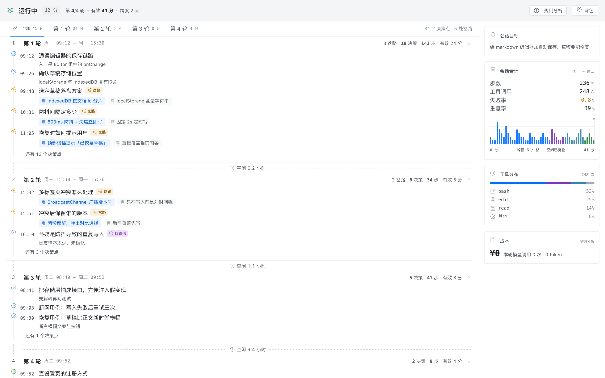

# 设计稿 · 观察视图 v9

这里放的是「观察」视图的**高保真设计稿**（单文件 HTML）。它还不是插件的实现——插件当前的 `client.js` 仍是旧界面，这版先以静态稿的形式把方向定下来。

打开方式：

```bash
open design/index.html
# 或者
python3 -m http.server 8899
# http://127.0.0.1:8899/design/index.html
```



## 这一版在做的事

把「观察」和「统计」合成一屏，左观察、右统计，互为索引：

- **左列**：按轮次分节的时间脊。每个决策点一行，岔路用分叉符号标出，选中的路实心、被放弃的路划掉。
- **右栏**：会话目标、合计、工具分布、成本。点任一数字，左列跳到对应轮次。
- **有效时间轴**：横轴只算真正在跑的时间，13 小时的过夜空闲折成一条虚线，不占横向空间。

## 设计来源

色板、圆角、字号、图标来自 UniFi Network 控制台的运行时产物（实测值，非目测）：

| 项 | 值 |
|---|---|
| 品牌蓝 | `#006eff`（深色 `#4797ff`） |
| 中性色 | 13 阶 `#ffffff → #212327` |
| 圆角 | 控件 4 / 容器 8 / 浮层 16 |
| 字号 | 9 / 11 / 13 / 15 |
| 发丝线 | `rgba(33,35,39,.07)`，深色 `rgba(249,250,250,.07)` |
| 间距基准 | 4px |

图标是 20×20 / 24×24 的单元素 SVG，`icons/` 下有 22 个，`icons/manifest.json` 记录来源。

## 文件

| 文件 | 说明 |
|---|---|
| `index.html` | 设计稿，自带明暗切换 |
| `data.js` | 演示数据（合成，虚构会话） |
| `unifi-icons.js` | 图标映射表 |
| `icons/` | 22 个 SVG + manifest |
| `check-icons.py` | 图标体检：查多 svg 叠加、path 重复、元素过多 |

## 数据说明

`data.js` 是**虚构**的一场会话（给 markdown 编辑器加自动保存），用来演示四种节点形态：

- `mile` 里程碑
- `fork` 岔路（含 `chosen` / `alt`）
- `dim` 低置信
- `live` 正在跑

接真实数据时，把插件 `lib/fold.js` 产出的 `beats` 映射成同样的结构即可。
